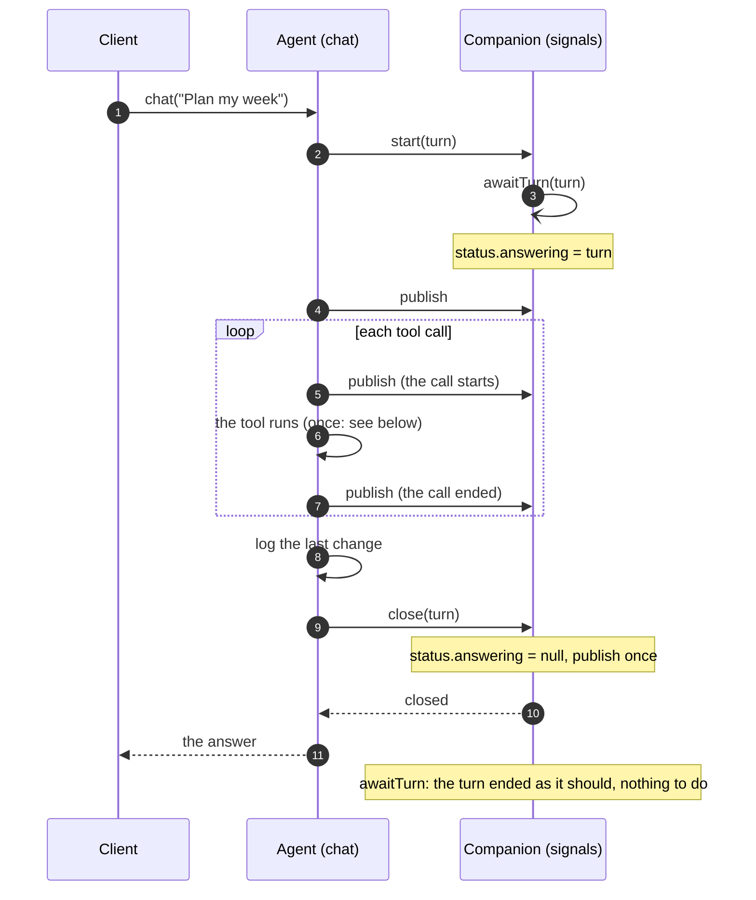
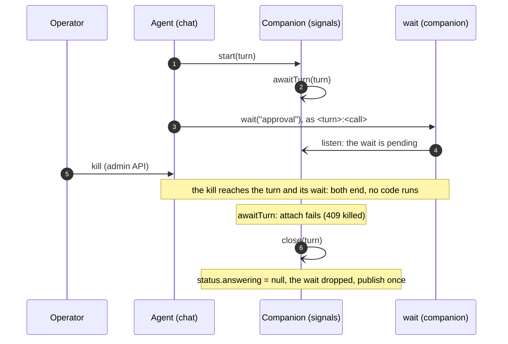
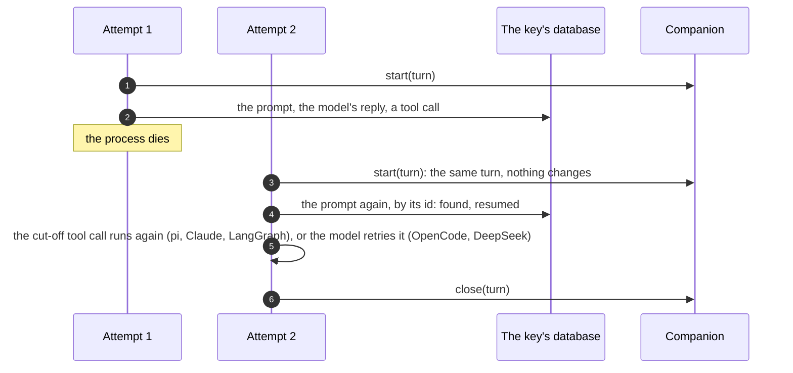

# Turn semantics

How an agent of `restate-agents` answers its messages: what a turn is, how
it starts and ends, what happens when it is retried, stopped or killed, and
what `status`, `pending` and a follower see along the way.

The code lives in [`src/common.ts`](src/common.ts) (`chatHandler`, the turn),
[`src/signals.ts`](src/signals.ts) (the companion) and
[`src/object.ts`](src/object.ts) (the views: `status`, `stop`, `clear`,
`sync`, `watch`).

## Words

- **Agent, key.** A session object of `restate-agents`, such as
  `assistant`, and one of its keys, such as `alice`: one conversation, in
  its own SQL database.
- **Message.** One call of the agent's `chat` handler: one Restate
  invocation, whose id (`inv_1f…`) is also the message's id.
- **Turn.** The agent answering one message: its `chat` invocation, from its
  start to its end. A turn is the invocation, not one run of it.
- **Attempt.** One run of a turn's invocation. A crash, a lost connection
  or a suspension ends an attempt; Restate starts another, which runs the
  handler again from its first line and resumes from what the database has.
- **Companion.** The agent's `signals` object, keyed `<agent>:<key>` (such
  as `assistant:alice`). It is a journaled virtual object, so it can wait
  (awakeables, timers) and be written while the turn runs. It keeps the
  running turn, the waits of its tools, and the conversation's revision.
- **Revision.** A number the companion increases at every change a client
  could see (`publish`). `watch` and `sync` wait for a newer one.

## One message at a time

A key answers one message at a time, in the order they came. `chat` is an
exclusive handler: a message sent while the agent answers another waits in
Restate's queue for the key, and its turn starts when the one before it
ended. There is no steering: a message never joins the turn being answered.

- **Answer now, or later.** `chat` answers with the answer. `chat/send`
  answers with the invocation's id at once, and
  `/restate/invocation/<id>/attach` waits for the answer, as often as you
  like.
- **Once.** A message sent with an idempotency key is one invocation,
  answered once, however often it is sent. A webhook's delivery (`deliver`)
  is a message of this kind, keyed by the delivery.
- **To change course,** stop the turn (`stop`) and send the message that
  replaces it: it is answered once the stopped turn ended, after any
  messages already waiting.

## A turn's life



1. **Start.** The turn calls the companion's `start(turn)`: from here,
   `status` says the agent answers it (`answering: {invocationId, since}`).
   A retried attempt calls `start` again with the same invocation, which
   changes nothing (it keeps when the turn started). `start` also sends
   `awaitTurn(turn)`, the turn's watch ([Ends](#how-a-turn-ends)).
2. **Steps.** The framework (pi, Claude, LangGraph, OpenCode, DeepSeek)
   answers: model calls and tool calls, its state in the key's database.
   Each tool call publishes as it starts and as it ends, after the log
   ([`log.ts`](src/log.ts)) takes the conversation as it is then, so a
   follower sees the call start and its result.
3. **End.** The turn writes the log's last change, then calls the
   companion's `close(turn)` and waits for it. `close` clears the turn and
   publishes: one revision for the turn's end, after its last write. Then
   the handler returns the answer, or throws the turn's error.

A **background** agent (`background: true`, a subagent say) publishes its
turn's end only: no step, nor its start, wakes a follower.

## How a turn ends

| How                                                  | The handler                       | Who closes the turn              | Then                                                                      |
| ---------------------------------------------------- | --------------------------------- | -------------------------------- | ------------------------------------------------------------------------- |
| **Answered**                                         | returns the answer                | the turn                         | idle; the next message starts                                             |
| **Refused** (a wrong API key, an unknown model)      | fails with HTTP 424, for good     | the turn                         | idle; the next message is answered on its own, not after it               |
| **Failed for good** (a terminal error)               | fails with it                     | the turn                         | idle                                                                      |
| **Stopped** (`stop`, `clear`, or Restate's cancel)   | fails with `CancelledError` (409) | the turn                         | idle; its tools' calls are cancelled, their waits forgotten               |
| **Crashed** (a process died, a retryable error)      | none yet: Restate runs it again   | nobody: the turn is not over     | still answering; the next attempt goes on with it                         |
| **Killed** (Restate's admin API)                     | runs no code                      | its watch (`awaitTurn`), at once | idle; its tools' waits dropped                                            |
| **Out of retries** (100 000 attempts, about 11 days) | runs no code                      | its watch, if Restate fails it   | idle; a turn Restate pauses instead stays answered until an operator acts |

Whoever closes it, a close does the same: it clears the turn (if the agent
still answers it), drops the waits of the turn's tools (rejecting their
awakeables, so a `wait` still parked ends), and publishes once if either
changed something. A second close of the same turn changes nothing, and
publishes nothing.

### The turn's watch

A turn closes itself only if its code runs to the end. A killed turn runs
none, so the companion watches each turn it starts: `awaitTurn(turn)`, a
shared handler, waits on the turn's invocation (`attach`), holding no
process, and closes the turn if it failed.



- **A turn that ends as it should** closed itself first: its `close` is a
  call it waits for before it ends, and the watch's `attach` returns only
  once it ended. The watch then does nothing.
- **A turn that failed** (killed, out of retries) gets closed by its watch,
  at once.
- **`attach` never hangs:** on a turn that ended before the watch began,
  it answers at once (with the answer, or 404 if Restate kept nothing),
  and a close then changes nothing.
- **An hour at most.** The watch races `attach` against an hour's sleep.
  A turn still answered then gets a new watch, and this one ends: no watch
  waits for weeks (a turn waiting for an approval, say) on the deployment
  it started on. A watch keeps no journal once done.
- **A cancelled watch** (an operator's) closes nothing: the turn may still
  run.
- **The next turn's `start`** also closes a turn before it that never
  closed, if its watch did not yet: a killed turn with a message queued
  behind it.

## Attempts: crashes and retries

A crash (a process that dies, a lost connection, a retryable error) ends an
attempt, not the turn. Restate runs the handler again from its first line,
and the turn goes on from what the database has:



- **The prompt, once.** A prompt's id is the invocation's id (then
  `<id>:2`, `<id>:3` for later prompts of the same invocation): every
  attempt asks the framework for the same prompt, which finds it stored,
  answered or unfinished, rather than asking the model again.
- **Tool calls, once.** A tool call has an idempotency key of the
  invocation and its call id, `<invocation>:<call id>`. Restate's own tools
  (`call`, `send`, `signal`, `subagent`, `workflow`) make their call once
  however often the tool call runs: a framework that gives a cut-off call a
  new id gets the earlier call's id back ([`calls.ts`](src/calls.ts)).
- **Waits survive.** A tool waiting for a signal waits in the companion
  (`wait`), by that key: the next attempt rejoins the same wait, and the
  turn is still answered meanwhile.
- **A dead attempt stops.** An attempt that ends while its process lives
  on (Restate suspended it, gave up on it, or lost its connection) stops
  its work, a model's request included: it can store nothing more, and the
  next attempt goes on. This is not a cancellation: the turn goes on.

## Stopping a turn

`stop` cancels the invocation of the message being answered: Restate's
cancellation, as its admin API's `PATCH /invocations/<id>/cancel`.

```mermaid
sequenceDiagram
  autonumber
  participant C as Client
  participant V as Agent (stop view)
  participant S as Companion
  participant A as Agent (chat)
  C->>V: stop
  V->>S: status (keyed by the stop request)
  S-->>V: answering: turn
  V-)A: cancel(turn)
  V-->>C: {stopped: turn}
  Note over A: the framework stops (a model request too), records the cut-off calls as cancelled
  Note over A: its tools' calls are cancelled: a wait forgets itself
  A->>S: close(turn)
  Note over S: idle, publish
  Note over A: fails with CancelledError; the next message waiting starts
```

- The view asks `status` with an idempotency key of its request: a `stop`
  that Restate runs again gets the same turn, and cancels it again (which
  does nothing), never the message that started after it.
- The turn ends cancelled whenever the cancellation comes, and the next
  message starts afresh: the cancelled prompt is over.
- A cancellation that comes once the turn answered changes nothing: the
  answer stands.
- `clear` stops the turn the same way, then forgets the conversation (the
  key's database, the companion's waits and kept signals). A message sent
  before `clear` is answered first, then forgotten too.

## What a client sees

| View                     | What it gives                                                                                        |
| ------------------------ | ---------------------------------------------------------------------------------------------------- |
| `status`                 | `answering`: the turn from its `start` to its close, or null; `waiting`: its tools' waits            |
| `pending`                | the waits, oldest first, each with its id (`<turn>:<call>`) for `signal`                             |
| `messages`               | the conversation as the log has it: what was said, with the tool calls and their outputs             |
| `notifications`, `watch` | the revision; `watch` waits (up to a minute) for a newer one                                         |
| `sync`                   | the revision, `status`, and the messages since a cursor, at once: what a follower (`follow()`) reads |

The revision increases at:

- a turn's start, and each of its tool calls' start and end (not in the
  background);
- a turn's close: its own, its watch's, or the next turn's `start` closing
  it;
- a wait that starts, is resolved by a `signal`, or is forgotten (a
  cancelled turn's);
- `clear`.

So a follower that reads each new revision sees every turn begin, its tool
calls, its end, and a killed turn go idle.

## Guarantees and limits

- **One turn at a time per key**, in the order messages came. A turn is
  never joined by another message.
- **`status` says the turn being answered** from its start to its close,
  however it ends: answered, refused, stopped, killed, or out of retries
  (if Restate fails it). A crashed turn is still being answered: it is.
- **A turn's waits end with it**: a cancelled turn's forget themselves; a
  killed turn's are dropped when it closes.
- **A turn's work is done once** across attempts: its prompt by its id,
  Restate's calls by their idempotency keys. A tool of your own does
  something once if it uses the idempotency key it is given.
- **Not covered:** waits started by a handler other than `chat` (your own
  handler that calls a framework's `prompt` with a `signal` tool) are not
  turns: if that handler is killed, its waits stay in `pending` until a
  `signal` resolves them or `clear` forgets them.
